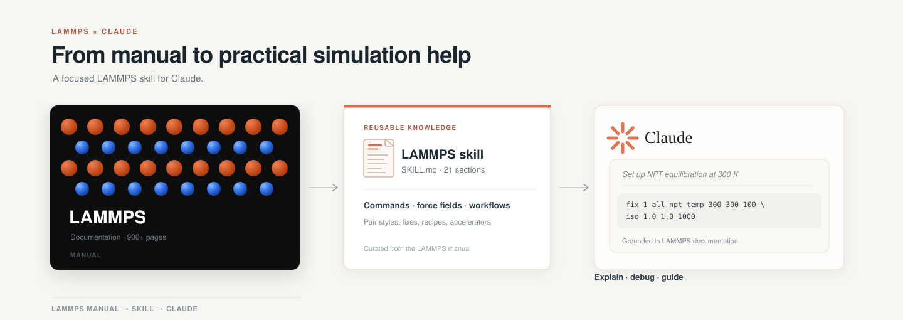

<p align="center">
  
</p>

A Claude AI skill for writing, debugging, and understanding LAMMPS
molecular dynamics simulations. Covers Release 30 Sep 2026.

## About

I spend most of my time setting up and running LAMMPS simulations of
mineral-water interfaces, and the same questions come up every time:
which atom style, which pair style, what does the data file need to look
like, what went wrong when it crashed. This skill teaches Claude all of
that so it can write correct input scripts, explain what a command does,
and catch the mistakes that cost queue hours.

The skill was distilled from the official LAMMPS manual (~900 pages)
into 21 topic-organized sections. It preserves version-specific syntax
and package requirements without copying the manual verbatim.

## Contents

| Section | Topic | What it covers |
|---|---|---|
| 1 | Input Script Structure | 7-part canonical order, syntax rules, variables, control flow |
| 2 | Units Systems | real, metal, lj, si, cgs, electron, micro, nano |
| 3 | Atom Styles | 14 styles from atomic to hybrid |
| 4 | Force Fields — Pair Styles | Simple, many-body, charged, CG, ML, reactive, water, hybrid |
| 5 | Bonded Interactions | Bond/angle/dihedral/improper + CHARMM, AMBER, OPLS, COMPASS, DREIDING, UFF compatibility |
| 6 | Fix Commands | Time integration, constraints, thermostats, walls, forces, advanced |
| 7 | Compute Commands | Thermodynamic, structural, property |
| 8 | Output | Dump styles, thermo keywords |
| 9 | Data File Format | Header/body structure, atom_style-dependent formats |
| 10 | Simulation Recipes | Minimization, equilibration, thermal conductivity, elastic constants, RDF, MSD, 2D |
| 11 | Accelerator Packages | GPU, KOKKOS, INTEL, OPENMP, OPT |
| 12 | Optional Packages | ~25 key packages of 95+ |
| 13 | Building LAMMPS | CMake workflow, presets, Python module |
| 14 | Python Interface | Library usage with code example |
| 15 | Variables and Expressions | Styles, operators, functions |
| 16 | Groups and Regions | Syntax examples |
| 17 | Restart, Read/Write | write_restart, read_restart, write_data |
| 18 | Common Errors | 8 typical issues + best practices |
| 19 | Multi-Replica Methods | NEB, PRD, TAD, temper, hyper |
| 20 | OpenKIM Integration | KIM model usage |
| 21 | AI-Assisted Scripting | Tips from manual Section 4.28 |

## How to use it

### As a Claude Code skill

Place `SKILL.md` in your project's skill directory and Claude loads it
automatically when you ask a LAMMPS question.

```bash
mkdir -p .claude/skills/lammps
cp SKILL.md .claude/skills/lammps/SKILL.md
```

### As a Claude.ai account skill

Upload `SKILL.md` as a skill in your Claude.ai settings. It activates
whenever you ask about LAMMPS input scripts, data files, force fields,
or simulation workflows.

### In a Claude Project

Copy the contents of `SKILL.md` into the project's custom instructions.

---

## What the skill does

Given a system description — say, hematite in contact with water and
sodium oleate — Claude will produce a complete input script with the
right units, atom style, pair style, force field coefficients, and
analysis setup. It flags which optional packages need to be compiled in
and warns about the things that usually go wrong (timestep too large,
missing kspace, lost atoms).

It handles the questions that come up during a project:

- "Write me an NPT equilibration for this system"
- "What pair style do I need for ReaxFF with charge equilibration?"
- "My simulation lost atoms at step 5000, what went wrong?"
- "How do I compute the RDF between water oxygen and surface iron?"
- "Convert this CHARMM setup to OPLS"
- "Build LAMMPS with GPU and ML-PACE support"

---

## Source

Generated from the official LAMMPS Documentation PDF (Release 30 Sep 2026,
GPLv2, https://docs.lammps.org/) using Claude AI. The manual was read
section by section and condensed into a structured reference that fits
inside a single skill file.

## License

MIT. See [LICENSE](LICENSE).
